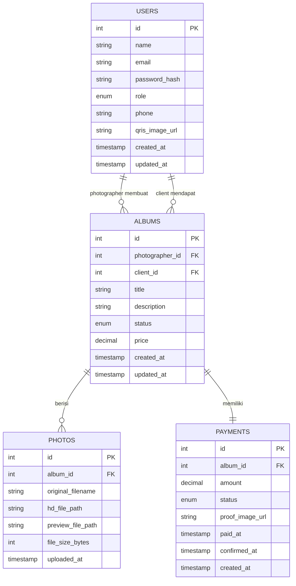

# 📸 Frame Safe — System Design Document

> Dirancang untuk junior fullstack developer | Tingkat SMA Kelas 11

---

## 1. Entity Relationship Diagram (ERD)

### Apa itu Entity?
Entity adalah "benda" atau "objek" di dunia nyata yang perlu kita simpan datanya di database. Bayangkan seperti tabel di Excel — setiap entity akan menjadi satu tabel.

### Entity yang Diperlukan



---

### Penjelasan Setiap Entity

#### 🧑 USERS
Mengapa satu tabel untuk dua jenis user (photographer & client)?

> [!TIP]
> **Keputusan Desain: Single Table untuk Multi-Role**
> 
> Daripada membuat dua tabel terpisah (`photographers` dan `clients`), kita gunakan satu tabel `users` dengan kolom `role`. Ini disebut **Single Table Inheritance**. Alasannya:
> - Login/autentikasi menjadi satu sistem yang seragam
> - Satu orang bisa jadi photographer sekaligus client di masa depan
> - Query lebih simpel
> - Lebih mudah di-maintain

| Kolom | Tipe | Keterangan |
|-------|------|------------|
| `id` | INT, AUTO_INCREMENT | Primary Key — ID unik tiap user |
| `name` | VARCHAR(100) | Nama lengkap |
| `email` | VARCHAR(150), UNIQUE | Email untuk login, harus unik |
| `password_hash` | VARCHAR(255) | Password yang sudah di-encrypt (bukan plaintext!) |
| `role` | ENUM('photographer','client') | Menentukan jenis user |
| `phone` | VARCHAR(20) | Nomor HP |
| `qris_image_url` | VARCHAR(500), NULLABLE | Foto QRIS — hanya diisi jika photographer |
| `created_at` | TIMESTAMP | Kapan akun dibuat |
| `updated_at` | TIMESTAMP | Kapan data terakhir diubah |

> [!NOTE]
> `qris_image_url` boleh NULL karena client tidak butuh QRIS. Kolom yang boleh kosong disebut **nullable**.

---

#### 📁 ALBUMS
Album adalah jembatan antara photographer dan client.

| Kolom | Tipe | Keterangan |
|-------|------|------------|
| `id` | INT, AUTO_INCREMENT | Primary Key |
| `photographer_id` | INT, FK → users.id | Siapa yang membuat album ini |
| `client_id` | INT, FK → users.id | Siapa client untuk album ini |
| `title` | VARCHAR(200) | Nama album (misal: "Wedding Budi & Sari") |
| `description` | TEXT, NULLABLE | Deskripsi tambahan |
| `status` | ENUM('draft','active','completed') | Status album |
| `price` | DECIMAL(12,2) | Harga yang harus dibayar client (misal: 1500000.00) |
| `created_at` | TIMESTAMP | Kapan album dibuat |
| `updated_at` | TIMESTAMP | Kapan terakhir diubah |

> [!NOTE]
> **Mengapa DECIMAL dan bukan INT untuk harga?**
> DECIMAL(12,2) menyimpan angka dengan 2 digit desimal. Untuk mata uang, ini penting agar akurat. INT tidak punya desimal, sedangkan FLOAT bisa menghasilkan angka aneh seperti `1499999.9999` akibat floating-point error.

> [!IMPORTANT]
> **Dua Foreign Key ke Tabel yang Sama**
> `photographer_id` dan `client_id` keduanya merujuk ke tabel `users`. Ini sah! SQL memperbolehkan ini. Artinya sebuah album punya dua "pemilik" dengan peran berbeda.

---

#### 🖼️ PHOTOS
Setiap foto punya dua versi: HD dan preview (watermark).

| Kolom | Tipe | Keterangan |
|-------|------|------------|
| `id` | INT, AUTO_INCREMENT | Primary Key |
| `album_id` | INT, FK → albums.id | Foto ini milik album mana |
| `original_filename` | VARCHAR(255) | Nama file asli saat di-upload |
| `hd_file_path` | VARCHAR(500) | Path ke file HD di server/storage |
| `preview_file_path` | VARCHAR(500) | Path ke file preview + watermark |
| `file_size_bytes` | INT | Ukuran file HD dalam bytes |
| `uploaded_at` | TIMESTAMP | Kapan foto di-upload |

> [!TIP]
> **Kenapa kita simpan PATH, bukan file-nya langsung?**
> Database bukan tempat menyimpan file gambar. Gambar disimpan di **file system** server atau cloud storage (seperti AWS S3, Cloudflare R2, atau Supabase Storage). Di database kita hanya simpan **lokasi/path** file tersebut. Ini jauh lebih efisien.

---

#### 💳 PAYMENTS
Mencatat transaksi pembayaran per album.

| Kolom | Tipe | Keterangan |
|-------|------|------------|
| `id` | INT, AUTO_INCREMENT | Primary Key |
| `album_id` | INT, FK → albums.id, UNIQUE | Satu album satu pembayaran |
| `amount` | DECIMAL(12,2) | Nominal yang harus/sudah dibayar |
| `status` | ENUM('pending','paid','confirmed') | Status pembayaran |
| `proof_image_url` | VARCHAR(500), NULLABLE | Foto bukti transfer dari client |
| `paid_at` | TIMESTAMP, NULLABLE | Kapan client upload bukti bayar |
| `confirmed_at` | TIMESTAMP, NULLABLE | Kapan photographer konfirmasi |
| `created_at` | TIMESTAMP | Kapan record payment dibuat |

> [!NOTE]
> **Mengapa `album_id` UNIQUE di tabel payments?**
> Karena satu album hanya boleh punya satu record pembayaran. Ini memastikan tidak ada duplikasi. Hubungan ini disebut **One-to-One** antara ALBUMS dan PAYMENTS.

---

## 2. Database Schema (SQL)

```sql
-- ============================================
-- FRAME SAFE DATABASE SCHEMA
-- ============================================

-- Tabel 1: Users (Photographer & Client)
CREATE TABLE users (
    id              INT AUTO_INCREMENT PRIMARY KEY,
    name            VARCHAR(100)    NOT NULL,
    email           VARCHAR(150)    NOT NULL UNIQUE,
    password_hash   VARCHAR(255)    NOT NULL,
    role            ENUM('photographer', 'client') NOT NULL,
    phone           VARCHAR(20),
    qris_image_url  VARCHAR(500),
    created_at      TIMESTAMP       DEFAULT CURRENT_TIMESTAMP,
    updated_at      TIMESTAMP       DEFAULT CURRENT_TIMESTAMP ON UPDATE CURRENT_TIMESTAMP
);

-- Tabel 2: Albums
CREATE TABLE albums (
    id              INT AUTO_INCREMENT PRIMARY KEY,
    photographer_id INT             NOT NULL,
    client_id       INT             NOT NULL,
    title           VARCHAR(200)    NOT NULL,
    description     TEXT,
    status          ENUM('draft', 'active', 'completed') DEFAULT 'draft',
    price           DECIMAL(12, 2)  NOT NULL DEFAULT 0.00,
    created_at      TIMESTAMP       DEFAULT CURRENT_TIMESTAMP,
    updated_at      TIMESTAMP       DEFAULT CURRENT_TIMESTAMP ON UPDATE CURRENT_TIMESTAMP,

    -- Foreign Key: photographer_id → users.id
    CONSTRAINT fk_album_photographer
        FOREIGN KEY (photographer_id) REFERENCES users(id) ON DELETE RESTRICT,

    -- Foreign Key: client_id → users.id
    CONSTRAINT fk_album_client
        FOREIGN KEY (client_id) REFERENCES users(id) ON DELETE RESTRICT
);

-- Tabel 3: Photos
CREATE TABLE photos (
    id                  INT AUTO_INCREMENT PRIMARY KEY,
    album_id            INT             NOT NULL,
    original_filename   VARCHAR(255)    NOT NULL,
    hd_file_path        VARCHAR(500)    NOT NULL,
    preview_file_path   VARCHAR(500)    NOT NULL,
    file_size_bytes     INT             NOT NULL DEFAULT 0,
    uploaded_at         TIMESTAMP       DEFAULT CURRENT_TIMESTAMP,

    -- Foreign Key: album_id → albums.id
    CONSTRAINT fk_photo_album
        FOREIGN KEY (album_id) REFERENCES albums(id) ON DELETE CASCADE
);

-- Tabel 4: Payments
CREATE TABLE payments (
    id              INT AUTO_INCREMENT PRIMARY KEY,
    album_id        INT             NOT NULL UNIQUE,  -- One-to-One dengan albums
    amount          DECIMAL(12, 2)  NOT NULL,
    status          ENUM('pending', 'paid', 'confirmed') DEFAULT 'pending',
    proof_image_url VARCHAR(500),
    paid_at         TIMESTAMP,
    confirmed_at    TIMESTAMP,
    created_at      TIMESTAMP       DEFAULT CURRENT_TIMESTAMP,

    -- Foreign Key: album_id → albums.id
    CONSTRAINT fk_payment_album
        FOREIGN KEY (album_id) REFERENCES albums(id) ON DELETE CASCADE
);
```

### Ringkasan Relasi Antar Tabel

```
users (1) ──────────── (N) albums  [sebagai photographer]
users (1) ──────────── (N) albums  [sebagai client]
albums (1) ─────────── (N) photos
albums (1) ─────────── (1) payments
```

| Relasi | Tipe | Penjelasan |
|--------|------|------------|
| User → Albums (sebagai photographer) | One-to-Many | Satu photographer bisa punya banyak album |
| User → Albums (sebagai client) | One-to-Many | Satu client bisa menerima banyak album |
| Album → Photos | One-to-Many | Satu album berisi banyak foto |
| Album → Payment | One-to-One | Satu album punya tepat satu record pembayaran |

---

## 3. Rancangan REST API

### Apa itu REST API?
REST API adalah cara server dan client (frontend) berkomunikasi. Bayangkan API seperti menu restoran — frontend "memesan" data atau aksi lewat **URL + HTTP Method**, dan backend "menyajikan" hasilnya dalam format **JSON**.

**HTTP Methods yang digunakan:**
| Method | Analogi | Digunakan untuk |
|--------|---------|----------------|
| `GET` | Minta/baca | Mengambil data |
| `POST` | Kirim/buat | Membuat data baru |
| `PUT` | Ganti semua | Update data (keseluruhan) |
| `PATCH` | Ganti sebagian | Update sebagian data |
| `DELETE` | Hapus | Menghapus data |

---

### 🔐 Authentication Endpoints

```
Base URL: /api/auth
```

| Method | Endpoint | Akses | Deskripsi |
|--------|----------|-------|-----------|
| `POST` | `/api/auth/register` | Public | Daftar akun baru |
| `POST` | `/api/auth/login` | Public | Login dan dapatkan token |
| `POST` | `/api/auth/logout` | Auth | Logout (invalidate token) |
| `GET`  | `/api/auth/me` | Auth | Lihat profil sendiri |

**Contoh Request — Login:**
```json
POST /api/auth/login
{
  "email": "budi@gmail.com",
  "password": "rahasia123"
}
```

**Contoh Response — Login Berhasil:**
```json
{
  "success": true,
  "data": {
    "token": "eyJhbGciOiJIUzI1NiIsInR5cCI6IkpXVCJ9...",
    "user": {
      "id": 1,
      "name": "Budi Fotografer",
      "email": "budi@gmail.com",
      "role": "photographer"
    }
  }
}
```

> [!IMPORTANT]
> **JWT Token**: Setelah login, server mengembalikan **JWT (JSON Web Token)**. Token ini dikirim di setiap request berikutnya dalam header `Authorization: Bearer <token>`. Ini cara server tahu "siapa yang sedang mengirim request ini" tanpa harus login ulang setiap saat.

---

### 👤 Photographer Endpoints

```
Base URL: /api/photographer
Akses: Harus login sebagai photographer
```

| Method | Endpoint | Deskripsi |
|--------|----------|-----------|
| `GET`  | `/api/photographer/profile` | Lihat profil photographer |
| `PUT`  | `/api/photographer/profile` | Update profil + upload QRIS |
| `GET`  | `/api/photographer/dashboard` | Ringkasan data (jumlah album, pendapatan, dll) |

---

### 📁 Album Endpoints

```
Base URL: /api/albums
```

| Method | Endpoint | Akses | Deskripsi |
|--------|----------|-------|-----------|
| `GET`  | `/api/albums` | Photographer | Lihat semua album milik photographer ini |
| `POST` | `/api/albums` | Photographer | Buat album baru |
| `GET`  | `/api/albums/:id` | Photographer / Client (yang punya) | Lihat detail album |
| `PUT`  | `/api/albums/:id` | Photographer (pemilik) | Update info album |
| `DELETE` | `/api/albums/:id` | Photographer (pemilik) | Hapus album |
| `GET`  | `/api/albums/client` | Client | Lihat semua album yang diberikan ke client ini |

> [!NOTE]
> **`:id` dalam URL** adalah **URL Parameter** — placeholder untuk ID spesifik. Misalnya `/api/albums/5` artinya "album dengan ID 5".

**Contoh Request — Buat Album:**
```json
POST /api/albums
Authorization: Bearer <photographer_token>

{
  "title": "Wedding Budi & Sari - 20 Oktober 2026",
  "description": "Foto pernikahan di gedung Aula Kencana",
  "client_id": 42,
  "price": 2500000
}
```

**Contoh Response:**
```json
{
  "success": true,
  "data": {
    "id": 7,
    "title": "Wedding Budi & Sari - 20 Oktober 2026",
    "status": "draft",
    "price": "2500000.00",
    "photographer_id": 1,
    "client_id": 42,
    "created_at": "2026-10-25T11:00:00Z"
  }
}
```

---

### 🖼️ Photo Upload Endpoints

```
Base URL: /api/albums/:albumId/photos
Akses: Photographer (pemilik album)
```

| Method | Endpoint | Deskripsi |
|--------|----------|-----------|
| `GET`  | `/api/albums/:albumId/photos` | Lihat semua foto dalam album |
| `POST` | `/api/albums/:albumId/photos` | Upload foto baru (multipart/form-data) |
| `DELETE` | `/api/albums/:albumId/photos/:photoId` | Hapus satu foto |

> [!TIP]
> **Nested Routes**: Endpoint foto diletakkan di bawah album (`/albums/:albumId/photos`) karena foto selalu bagian dari album. Ini disebut **nested resource** — mencerminkan hubungan One-to-Many di database.

**Contoh Request — Upload Foto:**
```
POST /api/albums/7/photos
Content-Type: multipart/form-data
Authorization: Bearer <photographer_token>

[file: DSC_0001.jpg]
```

> [!NOTE]
> **Proses di Backend saat Upload:**
> 1. Server menerima file JPEG dari photographer
> 2. Server menyimpan versi **HD** di storage
> 3. Server **membuat versi preview** dengan watermark (menggunakan library seperti Sharp.js)
> 4. Server menyimpan **path** kedua file ke tabel `photos`

---

### 💳 Payment Endpoints

```
Base URL: /api/albums/:albumId/payment
```

| Method | Endpoint | Akses | Deskripsi |
|--------|----------|-------|-----------|
| `GET`  | `/api/albums/:albumId/payment` | Photographer / Client | Lihat status pembayaran album |
| `POST` | `/api/albums/:albumId/payment` | Photographer | Buat tagihan pembayaran |
| `POST` | `/api/albums/:albumId/payment/proof` | Client | Upload bukti pembayaran |
| `PATCH` | `/api/albums/:albumId/payment/confirm` | Photographer | Konfirmasi pembayaran — buka akses HD |

> [!IMPORTANT]
> **Alur Pembayaran (Payment Flow):**
> ```
> [Photographer] → Buat tagihan (status: pending)
>       ↓
> [Client] → Lihat QRIS photographer → Transfer
>       ↓
> [Client] → Upload foto bukti transfer (status: paid)
>       ↓
> [Photographer] → Cek bukti → Konfirmasi (status: confirmed)
>       ↓
> [Sistem] → Akses foto HD terbuka untuk client ✅
> ```

**Contoh Response — Konfirmasi Pembayaran:**
```json
PATCH /api/albums/7/payment/confirm
Authorization: Bearer <photographer_token>

Response:
{
  "success": true,
  "message": "Pembayaran dikonfirmasi. Akses foto HD telah dibuka untuk client.",
  "data": {
    "payment_status": "confirmed",
    "confirmed_at": "2026-10-25T14:30:00Z",
    "album_status": "completed"
  }
}
```

---

### 📥 Photo Download Endpoint

```
Akses: Client yang sudah bayar LUNAS (payment status: confirmed)
```

| Method | Endpoint | Deskripsi |
|--------|----------|-----------|
| `GET`  | `/api/albums/:albumId/photos` | Lihat daftar foto (preview jika belum bayar, info HD jika sudah) |
| `GET`  | `/api/albums/:albumId/photos/:photoId/preview` | Download preview (dengan watermark) — selalu bisa diakses |
| `GET`  | `/api/albums/:albumId/photos/:photoId/download` | Download foto HD — hanya jika payment = confirmed |

> [!CAUTION]
> **Authorization Logic untuk Download HD:**
> Sebelum mengembalikan file HD, server WAJIB melakukan pengecekan:
> 1. Apakah user yang request adalah client dari album ini?
> 2. Apakah status payment album ini = `confirmed`?
> 
> Jika salah satu tidak terpenuhi → tolak dengan error `403 Forbidden`.
> Jangan pernah percaya frontend — validasi selalu di server!

---

## 4. Penjelasan Keputusan Desain

### 🔑 Kenapa Pakai Primary Key INT AUTO_INCREMENT?
ID angka integer yang auto-increment (1, 2, 3, ...) adalah pilihan paling umum dan efisien. Database lebih cepat mencari dan mengurutkan angka daripada teks. Alternatifnya adalah UUID (seperti `a3f8c2d1-...`) yang lebih unik secara global, tapi lebih lambat untuk indexing. Untuk skala proyek ini, INT sudah cukup.

### 🔗 Kenapa Pakai Foreign Key?
Foreign Key memastikan **integritas referensial** — artinya database tidak akan membiarkan kita punya data "yatim piatu". Contoh: kita tidak bisa menambah foto ke album yang tidak ada. Database akan otomatis menolak operasi tersebut.

### 🕒 Kenapa Selalu Ada `created_at` dan `updated_at`?
Kolom timestamp ini sangat berguna untuk:
- Audit trail: "kapan ini dibuat/diubah?"
- Debugging: mencari tahu urutan kejadian
- Fitur masa depan: sortir berdasarkan yang terbaru
Ini adalah **best practice** yang selalu diterapkan di production system.

### 🔒 Kenapa Password Tidak Disimpan Langsung?
Kolom `password_hash` menyimpan **hasil hash** password (menggunakan algoritma seperti bcrypt), bukan password aslinya. Jika database bocor/diretas, attacker tidak bisa mengetahui password asli user. **Tidak ada sistem yang baik menyimpan password plaintext.**

### 📊 Mengapa Memisahkan Tabel Payments dari Albums?
Meskipun setiap album hanya punya satu payment, kita tetap pisahkan ke tabel berbeda. Ini mengikuti prinsip **Single Responsibility** — setiap tabel punya satu tanggung jawab. Tabel `albums` tentang album, tabel `payments` tentang pembayaran. Ke depannya jika sistem pembayaran berkembang (misal: cicilan, refund), tidak perlu mengubah struktur tabel `albums`.

---

## 5. Ringkasan Arsitektur Sistem

```
CLIENT (Browser/App)
        │
        │ HTTP Request (JSON)
        ▼
   REST API SERVER
   ┌─────────────────────────────┐
   │  Route → Controller         │
   │  Middleware: Auth (JWT)     │
   │  Middleware: Role Check     │
   │  Business Logic             │
   └────────────┬────────────────┘
                │
        ┌───────┴───────┐
        ▼               ▼
   DATABASE         FILE STORAGE
   (MySQL/           (Local /
   PostgreSQL)       Cloud S3)
   - users           - /hd/*.jpg
   - albums          - /preview/*.jpg
   - photos
   - payments
```

---

## 6. Langkah Implementasi yang Disarankan

- `[ ]` Setup project (Node.js + Express atau Laravel)
- `[ ]` Buat database dan jalankan schema SQL di atas
- `[ ]` Implementasi auth (register, login, JWT)
- `[ ]` Buat endpoint album (CRUD)
- `[ ]` Buat sistem upload foto + generate watermark preview
- `[ ]` Buat endpoint payment (buat tagihan, upload bukti, konfirmasi)
- `[ ]` Buat endpoint download dengan authorization check
- `[ ]` Testing setiap endpoint

> [!TIP]
> **Rekomendasi Tech Stack untuk Pemula:**
> - **Backend**: Node.js + Express.js (JavaScript, sama dengan frontend)
> - **Database**: MySQL atau PostgreSQL
> - **Auth**: JSON Web Token (JWT) via library `jsonwebtoken`
> - **Upload & Watermark**: Multer (upload) + Sharp.js (proses gambar)
> - **Testing API**: Gunakan Postman atau Thunder Client (VS Code extension)
